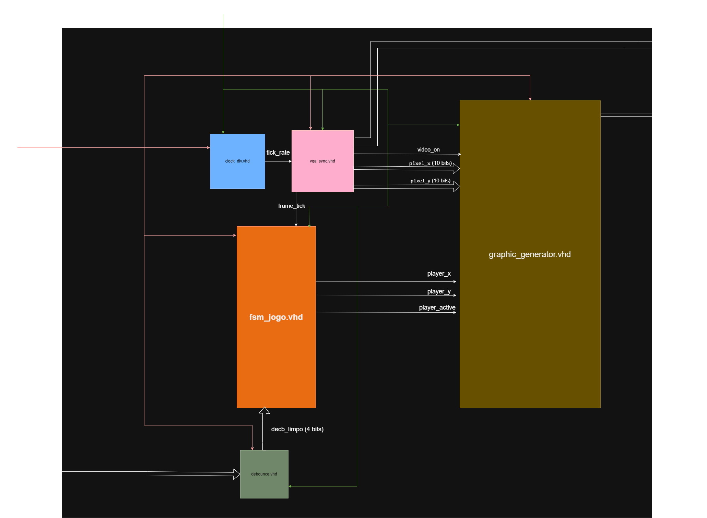

# Jogo 2D Interativo em FPGA

Este é o relatório parcial do projeto de um jogo digital 2D interativo implementado em VHDL, utilizando uma placa FPGA.    
O objetivo final é implementar um jogo, exibido em um monitor padrão através de uma interface VGA na resolução de 640x480 pixels, que possua mecânicas inspiradas em *Undertale* e *Asteroids*.    
Para a entrega parcial, foi feito o sistema de movimentação do personagem, os módulos de controle do VGA e do Clock, e os módulos de Debouncer e Geração de Gráficos.

## Equipe
- **Arthur Neves:** VGA e Clock
- **Paola Perim:** Gráficos e Entrada
- **Rodrigo Namora:** FSM e Física

## Estrutura do Projeto
- `src/`: Arquivos de código fonte VHDL (`.vhd`, `.vhdl`). Os principais módulos incluem:
  - `main.vhd`: Módulo principal (Top Level)
  - `clock_div.vhd` e `vga_sync.vhd`: Módulos de clock e sincronismo VGA
  - `fsm_jogo.vhd`: Máquina de estados e lógica de física/colisão
  - `gerador_grafico.vhd`: Renderização gráfica
  - `debouncer.vhd`: Tratamento de ruídos mecânicos dos botões
- `tb/`: Testbenches para validação e simulação isolada e de integração dos módulos
- `sim/`: Scripts de simulação e arquivos de forma de onda (`.vcd`, `.ghw`)

## Ferramentas Recomendadas e Validação
- **Simulador:** GHDL
- **Visualizador de Formas de Onda:** GTKWave

## Módulos implementados
- `modulo_movimento.vhd`: Estabelece o movimento do personagem com os botões direcionais `decb (direita, esquerda, cima, baixo)`, que na placa foram os botões`T16, U15, T14, T15`, nessa ordem. Além disso, implementa uma lógica de colisão com as bordas do monitor. Permite movimento na diagonal, e trava o personagem ao tentar andar em direções opostas ao mesmo tempo. Futuras mudanças podem ser alterar a velocidade e/ou tamanho do jogador, dependendo da jogabilidade observada.
- `clock_div.vhd`: Estabelece o sinal de clock do jogo através do pino `E12`, que garante a sincronia dos componentes e controla quando os passos podem ser feitos. A frequência usada foi de `25MHz`, em função da resolução desejada.
- `vga_sync.vhd`: Estabelece os sinais de `h_sync` e `v_sync` que estão conectados aos pinos `C11` e `B11` da placa, no conector do cabo VGA. Só funciona para VGA em resoluções de até 640x480 pixels.
- `debouncer.vhd`: Estabelece um filtro para os sinais de entrada `decb`, de forma que trepidações ou instabilidades físicas sejam desconsideradas, e enviando o sinal `decb_limpo` para o módulo de movimento.
- `gerador_grafico.vhd`: Responsável por ditar as cores no monitor VGA, traduzindo a lógica do jogo para as ações que ocorrem na tela.  Atualmente usa um bit para cada saída (bit mais significativo de R, G e B), nos pinos `C8, D6 e C9`. Isso limita o total de cores possíveis de serem representadas (8 cores). Para o projeto final, um escopo de melhoria seria utilizar os 4 bits de cada saída para poder definir todas as cores possíveis desse sistema RGB. 

## Diagramas de Blocos
Abaixo, o esquema e diagrama de blocos para melhor detalhar as entradas, saídas e interações de cada módulo implementado nessa entrega parcial.

## Testes de simulação realizados
Além do teste na placa, que foi bem sucedido, realizamos simulações via testbenches pelo `GTKWave`, arquivos que estão localizados no diretório `tb/` do projeto.

